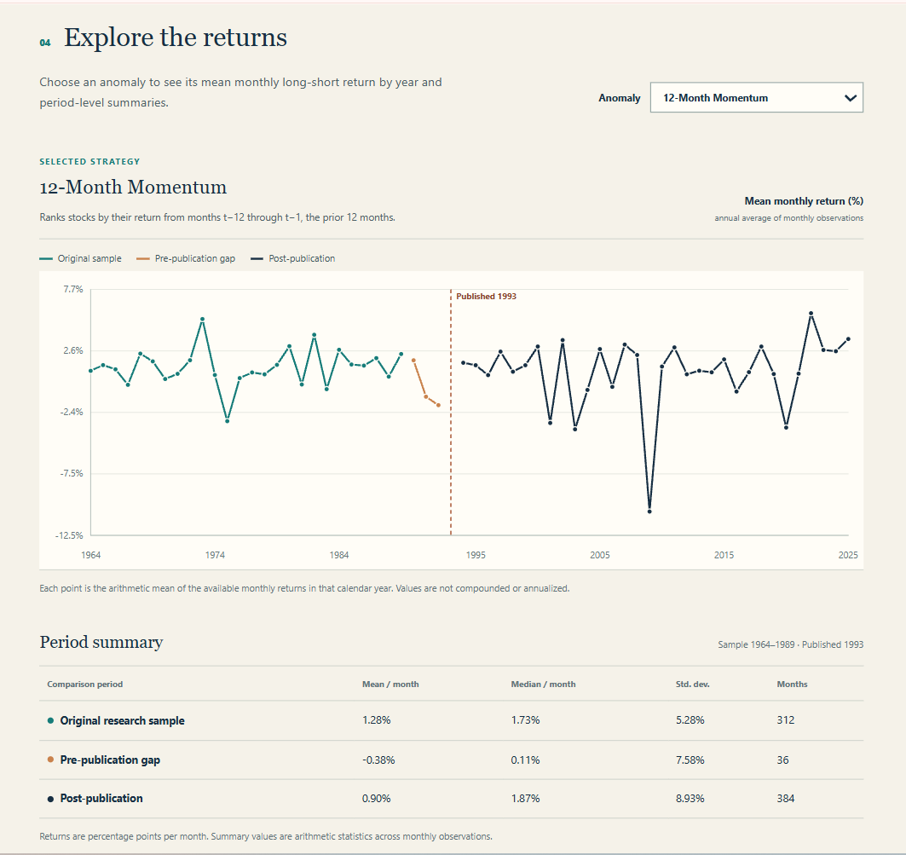

# Research Proposal: Did Academic Research Kill the Anomalies?

**Team Name:** Team 7 :)

**Team Members:** Iciar Gorospe Valenzuela, Janani Vittal, Elizabeth Handler and Gemma Formisano

## Research Question & Motivation

**Research Question:** Do investment anomalies become less profitable after they are published in academic research, and what determines which ones continue to perform well?

We chose this topic because we found it interesting that publishing research about a profitable investment strategy could actually make that strategy less useful. Once a strategy becomes public knowledge, more investors may start using it, which could potentially reduce the opportunity to earn abnormal returns. In other words, the research that identifies a profitable strategy could also contribute to its decline.

Our goal is to investigate whether this actually happens and whether certain types of strategies are more likely to remain profitable after publication than others. We're also interested in whether harder-to-trade strategies hold up better. This question is especially relevant to quantitative researchers and portfolio managers, who need to determine which investment strategies are still worth using rather than relying on past performance alone. Hedge funds and asset management firms may pay for this research to help them make those decisions.

## Data

### Source and Dataset

We use data from the October 2026 release of Open Asset Pricing (OpenAP), developed by Andrew Chen and Tom Zimmermann. The dataset provides historical returns for hundreds of investment anomalies, along with information about the academic studies that introduced them.

Our dataset has **one observation per anomaly per month**. Each row includes the anomaly name, month, monthly long-short return, publication year, original research sample start and end years, period classification, pre/post-publication indicator, economic category, and data category. Returns are measured in percentages.

Our initial prototype focuses on five anomalies: Book-to-Market, Initial Public Offerings, 12-Month Momentum, Accruals, and Asset Growth. It currently contains **4,454 anomaly-month observations**, of which 3,524 fall within our three main comparison periods.

### Example Observations

The following are actual observations from our dataset for the 12-Month Momentum strategy, showing all 10 columns:

| signalname | month   | ret (%) | publication_year | period              | post_publication | economic_category | data_category | sample_start_year | sample_end_year |
| ---------- | ------- | ------: | ---------------: | ------------------- | ---------------: | ----------------- | ------------- | ----------------: | --------------: |
| Mom12m     | 1989-12 |    5.43 |             1993 | Original Sample     |                0 | momentum          | Price         |              1964 |            1989 |
| Mom12m     | 1990-01 |   -7.90 |             1993 | Pre-Publication Gap |                0 | momentum          | Price         |              1964 |            1989 |
| Mom12m     | 1994-01 |   -4.67 |             1993 | Post-Publication    |                1 | momentum          | Price         |              1964 |            1989 |

The Momentum anomaly was published in 1993, with an original research sample covering 1964-1989. These observations show how we classify returns based on when they occurred relative to the original sample and publication year.

### Sample Period and Restrictions

Our prototype dataset covers January 1927 through December 2025, although available dates vary by anomaly. We plan to expand our analysis to the rest of the OpenAP dataset.

We divide each anomaly's returns into three main periods:

- **Original Sample =** years included in the original academic study
- **Pre-Publication Gap** = years between the end of the original sample and publication
- **Post-Publication =** years after the study was published

We exclude observations before the original research sample and during the publication year from our main comparisons. We chose to exclude the publication year because we only have the year, not the exact publication date.

We didn't restrict our analysis to specific industries because we're studying investment strategies that can include stocks from many different sectors.

### Must-Have vs. Nice-to-Have Variables

Our main analysis requires the anomaly name, monthly long-short returns, publication year, original research sample dates, and anomaly category. These variables allow us to compare profitability before and after publication and examine whether certain types of anomalies perform better than others.

We would also like to include measures of trading difficulty, such as transaction costs, bid-ask spreads, firm size, and trading volume. These would help us investigate whether anomalies that are harder to trade are more likely to remain profitable after publication. We haven't incorporated these measures yet and will need to explore available data sources as we expand our analysis.

### Data Sources and Storage

We access OpenAP using the `openassetpricing` Python package and download two main inputs: monthly long-short portfolio returns and anomaly documentation containing the publication years, original sample dates, and categories.

Our raw inputs are downloaded directly from OpenAP rather than stored as separate files in the repository. The code for downloading and combining them is in `01_seed4_poc.ipynb`, which saves the resulting dataset as `outputs/checkpoint1_sample.csv`. We also save `outputs/explorer_data.json` for our website and `outputs/period_summary.csv` for our summary results. Anyone can reproduce these by following the instructions in our README.

## Method

### Data Processing Pipeline

Our project uses an automated Python pipeline that downloads, processes, and analyzes the data. The main steps are:

1. **Download and organize the data:** In `01_seed4_poc.ipynb`, we combine OpenAP's portfolio returns and anomaly documentation, classify observations based on their relationship to the publication year, and save the dataset as `outputs/checkpoint1_sample.csv`.

2. **Prepare the website data:** In `prepare_data.py`, we calculate average monthly returns for each anomaly across our three comparison periods. We also calculate annual averages for the charts and save the results in `outputs/explorer_data.json`.

3. **Generate our results table:** In `run_all.py`, we automate the entire process and save a summary of each anomaly's average monthly returns and number of observations in `outputs/period_summary.csv`.

The entire process can be reproduced by running `python run_all.py`.

### Planned Analysis

Our analysis will follow our three main questions:

**1. Do anomalies become less profitable after publication?**

We will compare each anomaly's average monthly returns during its original research sample and then after publication. We will also examine the pre-publication gap separately to see whether profitability started declining before the research was published. Our main comparisons will use all available observations, and we'll rely on equal-length periods as an additional robustness check.

We also plan to run regressions to test whether the changes in returns are statistically significant (rather than just observing the differences in averages).

**2. Which types of anomalies are more likely to remain profitable?**

We will group anomalies by their economic and data categories and compare how much their profitability changes after publication. This will help us identify whether certain types of investment strategies tend to perform better than others once they become publicly known.

**3. Does trading difficulty affect how well anomalies perform after publication?**

We will explore whether strategies that are harder or more expensive to trade experience smaller declines in profitability. To do this, we plan to examine measures such as transaction costs, bid-ask spreads, firm size, and trading volume.

## Threats to Validity and Checks

There are several potential issues we need to consider when interpreting our results:

- **Correlation vs. causation:** A decline in returns after publication doesn't necessarily mean that the publication directly caused it. Other factors, such as changing market conditions or investor behavior, could also explain the change. → We will examine the pre-publication gap separately and avoid making claims implying causation based only on our results.

- **Data mining:** Anomalies may appear especially profitable during their original research samples because researchers discovered them using that same set of data. → We will compare these returns with both the pre-publication gap and post-publication periods to try and flag this possibility.

- **Look-ahead and selection bias:** We need to make sure investment strategies only use information that would have been available at the time and that our sample isn't biased toward certain types of anomalies. → We will examine OpenAP's portfolio construction and then expand beyond our five-anomaly prototype.

- **Unequal sample periods:** Some anomalies have more available observations before or after publication than others. → We will use equal-length comparison periods as a robustness check.

- **Trading costs:** Our current returns don't account for additional trading costs, which could reduce actual profitability. → We plan to explore these costs and other measures of trading difficulty.

- **Data accuracy and reproducibility:** We use validation checks to identify duplicate observations, missing information, incorrect dates, and unmatched merges. We also independently checked calculations and successfully tested our full pipeline in a fresh Colab notebook.

- **Selective reporting and AI-related risks:** We will document the different analyses we test in `specs_tried.md` to avoid only reporting favorable results. We don't use AI-generated financial predictions or historical outcomes as inputs for our analysis.

## Dashboard Mockup

Our dashboard will allow users to explore how investment anomalies perform before and after publication. Users will be able to select an anomaly, view its historical returns, identify when the original research was published, and compare summary statistics across our three main periods.

The screenshot below shows our current working prototype using the 12-Month Momentum anomaly.

**Live Dashboard:** [Explore our interactive prototype](https://iciargorospe.github.io/FIN331_FinalProject/)

As we expand our analysis, we plan to add comparisons across anomaly categories, statistical test results, and measures of trading difficulty. Our goal is to make it easy for users to identify which investment strategies have maintained their profitability after publication and explore possible explanations for the differences.
